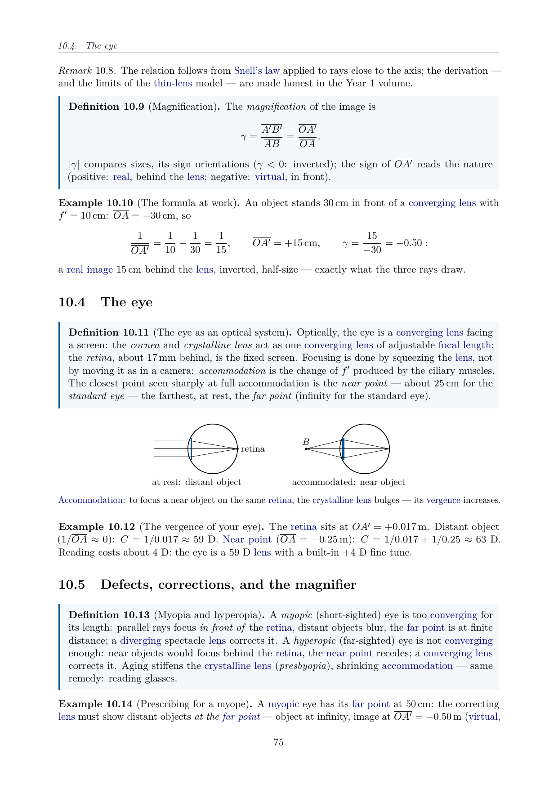
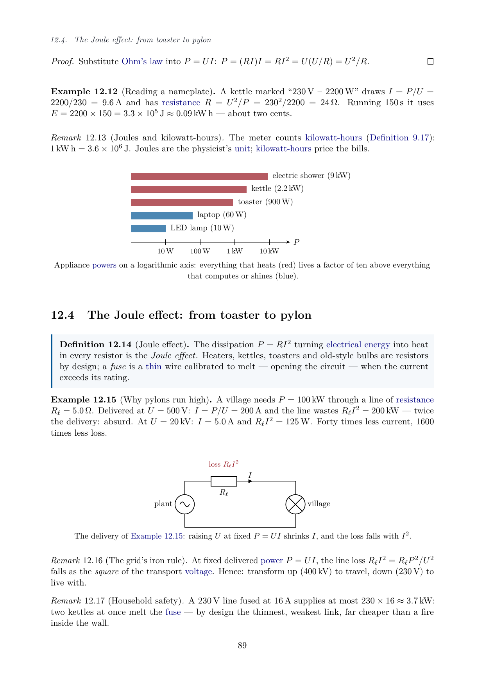
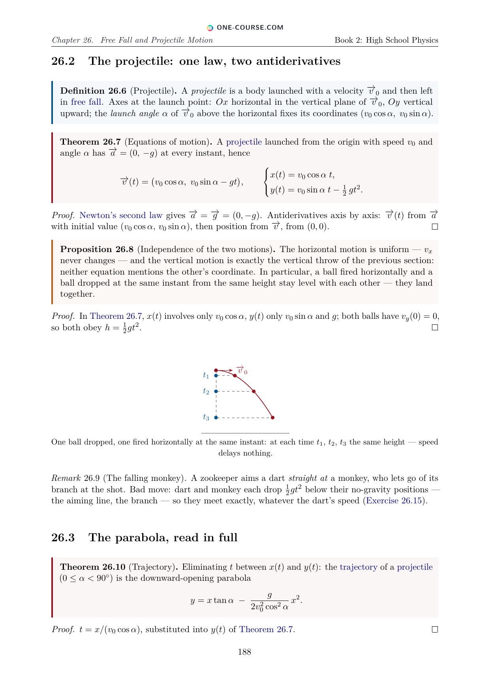

# One Physics Book

<p align="center">
  <a href="https://one-course.com">
    
  </a>
</p>

<p align="center">
  <a href="https://github.com/bvirrion/one-physics-book/releases/latest"></a>
  <a href="https://github.com/bvirrion/one-physics-book/releases"></a>
  <a href="https://github.com/bvirrion/one-physics-book/actions/workflows/release.yml"></a>
  <a href="https://one-course.com/books"></a>
</p>

*The One Physics Book to Rule Them All.*

> **One Physics Book** is part of the **One Course** project — one coherent
> course covering each subject from kindergarten to the end of the
> bachelor's degree. Discover the whole project at
> **[one-course.com](https://one-course.com)**, and see the siblings
> [One Math Book](https://github.com/bvirrion/one-math-book),
> [One Chemistry Book](https://github.com/bvirrion/one-chemistry-book),
> [One Biology Book](https://github.com/bvirrion/one-biology-book),
> [One Earth and Space Sciences Book](https://github.com/bvirrion/one-earth-and-space-sciences-book),
> [One Computer Science Book](https://github.com/bvirrion/one-computer-science-book),
> [One Economics Book](https://github.com/bvirrion/one-economics-book) and
> [One Quant Book](https://github.com/bvirrion/one-quant-book).

A series of five **free physics textbooks** forming a
single coherent course **from Grade 1 to the end of the bachelor's
degree** — one notation, one voice, every year building on the previous
one. **All five books are complete**, each in eight editions:
**English, French, Dutch, Spanish, Portuguese, Hindi, Arabic and
Indonesian**, plus a **Simplified Chinese** edition (PDF only for now) —
free to read online or download for students, parents, teachers and
homeschooling families:

1. **Primary & Middle School Physics** — Grades 1–9;
2. **High School Physics** — Grades 10–12;
3. **University Physics — Year 1**;
4. **University Physics — Year 2**;
5. **University Physics — Year 3**.

The course is **physics only** (no chemistry), and it truly starts in
Grade 1: the early grades are covered by age-adapted chapters.

The style is concise and rigorous: courses built from **definitions,
examples, propositions, theorems and methods**, with derivations whenever
they are accessible at the given level (results admitted without proof are
explicitly marked), followed by graded **exercises with full solutions**
collected at the end of each book. Thousands of generated hyperlinks send
every defined term back to its definition, and every exercise to its
solution.

<p align="center">
  
  
  
</p>
<p align="center"><sub>Three pages from Book 2 (High School): optics of the eye, the Joule effect, projectile motion.</sub></p>

## Read online · Download the PDFs

| Book | Read online | Download PDF |
|------|-------------|--------------|
| **1. Primary & Middle School** (Grades 1–9) | [EN](https://one-course.com/books/physics/1/en) · [ES](https://one-course.com/books/physics/1/es) · [FR](https://one-course.com/books/physics/1/fr) · [HI](https://one-course.com/books/physics/1/hi) · [AR](https://one-course.com/books/physics/1/ar) · [ID](https://one-course.com/books/physics/1/id) · [NL](https://one-course.com/books/physics/1/nl) · [PT](https://one-course.com/books/physics/1/pt) | [EN](https://github.com/bvirrion/one-physics-book/releases/latest/download/one_physics_book_1_primary_middle_school.pdf) · [ES](https://github.com/bvirrion/one-physics-book/releases/latest/download/one_physics_book_1_primary_middle_school_es.pdf) · [FR](https://github.com/bvirrion/one-physics-book/releases/latest/download/one_physics_book_1_primary_middle_school_fr.pdf) · [HI](https://github.com/bvirrion/one-physics-book/releases/latest/download/one_physics_book_1_primary_middle_school_hi.pdf) · [AR](https://github.com/bvirrion/one-physics-book/releases/latest/download/one_physics_book_1_primary_middle_school_ar.pdf) · [ID](https://github.com/bvirrion/one-physics-book/releases/latest/download/one_physics_book_1_primary_middle_school_id.pdf) · [NL](https://github.com/bvirrion/one-physics-book/releases/latest/download/one_physics_book_1_primary_middle_school_nl.pdf) · [PT](https://github.com/bvirrion/one-physics-book/releases/latest/download/one_physics_book_1_primary_middle_school_pt.pdf) · [ZH](https://github.com/bvirrion/one-physics-book/releases/latest/download/one_physics_book_1_primary_middle_school_zh.pdf) |
| **2. High School** (Grades 10–12) | [EN](https://one-course.com/books/physics/2/en) · [ES](https://one-course.com/books/physics/2/es) · [FR](https://one-course.com/books/physics/2/fr) · [HI](https://one-course.com/books/physics/2/hi) · [AR](https://one-course.com/books/physics/2/ar) · [ID](https://one-course.com/books/physics/2/id) · [NL](https://one-course.com/books/physics/2/nl) · [PT](https://one-course.com/books/physics/2/pt) | [EN](https://github.com/bvirrion/one-physics-book/releases/latest/download/one_physics_book_2_high_school.pdf) · [ES](https://github.com/bvirrion/one-physics-book/releases/latest/download/one_physics_book_2_high_school_es.pdf) · [FR](https://github.com/bvirrion/one-physics-book/releases/latest/download/one_physics_book_2_high_school_fr.pdf) · [HI](https://github.com/bvirrion/one-physics-book/releases/latest/download/one_physics_book_2_high_school_hi.pdf) · [AR](https://github.com/bvirrion/one-physics-book/releases/latest/download/one_physics_book_2_high_school_ar.pdf) · [ID](https://github.com/bvirrion/one-physics-book/releases/latest/download/one_physics_book_2_high_school_id.pdf) · [NL](https://github.com/bvirrion/one-physics-book/releases/latest/download/one_physics_book_2_high_school_nl.pdf) · [PT](https://github.com/bvirrion/one-physics-book/releases/latest/download/one_physics_book_2_high_school_pt.pdf) · [ZH](https://github.com/bvirrion/one-physics-book/releases/latest/download/one_physics_book_2_high_school_zh.pdf) |
| **3. University — Year 1** | [EN](https://one-course.com/books/physics/3/en) · [ES](https://one-course.com/books/physics/3/es) · [FR](https://one-course.com/books/physics/3/fr) · [HI](https://one-course.com/books/physics/3/hi) · [AR](https://one-course.com/books/physics/3/ar) · [ID](https://one-course.com/books/physics/3/id) · [NL](https://one-course.com/books/physics/3/nl) · [PT](https://one-course.com/books/physics/3/pt) | [EN](https://github.com/bvirrion/one-physics-book/releases/latest/download/one_physics_book_3_university_year_1.pdf) · [ES](https://github.com/bvirrion/one-physics-book/releases/latest/download/one_physics_book_3_university_year_1_es.pdf) · [FR](https://github.com/bvirrion/one-physics-book/releases/latest/download/one_physics_book_3_university_year_1_fr.pdf) · [HI](https://github.com/bvirrion/one-physics-book/releases/latest/download/one_physics_book_3_university_year_1_hi.pdf) · [AR](https://github.com/bvirrion/one-physics-book/releases/latest/download/one_physics_book_3_university_year_1_ar.pdf) · [ID](https://github.com/bvirrion/one-physics-book/releases/latest/download/one_physics_book_3_university_year_1_id.pdf) · [NL](https://github.com/bvirrion/one-physics-book/releases/latest/download/one_physics_book_3_university_year_1_nl.pdf) · [PT](https://github.com/bvirrion/one-physics-book/releases/latest/download/one_physics_book_3_university_year_1_pt.pdf) · [ZH](https://github.com/bvirrion/one-physics-book/releases/latest/download/one_physics_book_3_university_year_1_zh.pdf) |
| **4. University — Year 2** | [EN](https://one-course.com/books/physics/4/en) · [ES](https://one-course.com/books/physics/4/es) · [FR](https://one-course.com/books/physics/4/fr) · [HI](https://one-course.com/books/physics/4/hi) · [AR](https://one-course.com/books/physics/4/ar) · [ID](https://one-course.com/books/physics/4/id) · [NL](https://one-course.com/books/physics/4/nl) · [PT](https://one-course.com/books/physics/4/pt) | [EN](https://github.com/bvirrion/one-physics-book/releases/latest/download/one_physics_book_4_university_year_2.pdf) · [ES](https://github.com/bvirrion/one-physics-book/releases/latest/download/one_physics_book_4_university_year_2_es.pdf) · [FR](https://github.com/bvirrion/one-physics-book/releases/latest/download/one_physics_book_4_university_year_2_fr.pdf) · [HI](https://github.com/bvirrion/one-physics-book/releases/latest/download/one_physics_book_4_university_year_2_hi.pdf) · [AR](https://github.com/bvirrion/one-physics-book/releases/latest/download/one_physics_book_4_university_year_2_ar.pdf) · [ID](https://github.com/bvirrion/one-physics-book/releases/latest/download/one_physics_book_4_university_year_2_id.pdf) · [NL](https://github.com/bvirrion/one-physics-book/releases/latest/download/one_physics_book_4_university_year_2_nl.pdf) · [PT](https://github.com/bvirrion/one-physics-book/releases/latest/download/one_physics_book_4_university_year_2_pt.pdf) · [ZH](https://github.com/bvirrion/one-physics-book/releases/latest/download/one_physics_book_4_university_year_2_zh.pdf) |
| **5. University — Year 3** | [EN](https://one-course.com/books/physics/5/en) · [ES](https://one-course.com/books/physics/5/es) · [FR](https://one-course.com/books/physics/5/fr) · [HI](https://one-course.com/books/physics/5/hi) · [AR](https://one-course.com/books/physics/5/ar) · [ID](https://one-course.com/books/physics/5/id) · [NL](https://one-course.com/books/physics/5/nl) · [PT](https://one-course.com/books/physics/5/pt) | [EN](https://github.com/bvirrion/one-physics-book/releases/latest/download/one_physics_book_5_university_year_3.pdf) · [ES](https://github.com/bvirrion/one-physics-book/releases/latest/download/one_physics_book_5_university_year_3_es.pdf) · [FR](https://github.com/bvirrion/one-physics-book/releases/latest/download/one_physics_book_5_university_year_3_fr.pdf) · [HI](https://github.com/bvirrion/one-physics-book/releases/latest/download/one_physics_book_5_university_year_3_hi.pdf) · [AR](https://github.com/bvirrion/one-physics-book/releases/latest/download/one_physics_book_5_university_year_3_ar.pdf) · [ID](https://github.com/bvirrion/one-physics-book/releases/latest/download/one_physics_book_5_university_year_3_id.pdf) · [NL](https://github.com/bvirrion/one-physics-book/releases/latest/download/one_physics_book_5_university_year_3_nl.pdf) · [PT](https://github.com/bvirrion/one-physics-book/releases/latest/download/one_physics_book_5_university_year_3_pt.pdf) · [ZH](https://github.com/bvirrion/one-physics-book/releases/latest/download/one_physics_book_5_university_year_3_zh.pdf) |

All eight editions of every book can be read online, chapter by chapter (the
Chinese edition is PDF only for now), and the PDF links always point at the
newest release. Spotted a mistake? Please
[report an erratum](https://github.com/bvirrion/one-physics-book/issues/new?template=errata.yml) —
fixes usually ship within days.

## Current status

**All five books are written, and every one ships in eight complete
editions** (English, French, Dutch, Spanish, Portuguese, Hindi, Arabic and
Indonesian — same chapters, same labels, same figures): 194 chapters in all.

| Book | Level | Status |
|------|-------|--------|
| Primary & Middle School | Grades 1–9 (age 6–15) | ✅ 71 chapters, exercises, weekend problems from Grade 6, solutions — about 435 pages |
| High School | Grades 10–12 (age 15–18) | ✅ 35 chapters, 525 exercises, 35 weekend problems, solutions — about 350 pages |
| University — Year 1 | Bachelor Year 1 (age 18–19) | ✅ 30 chapters, 360 exercises, 30 weekend problems, solutions — about 330 pages |
| University — Year 2 | Bachelor Year 2 (age 19–20) | ✅ 31 chapters, 372 exercises, 31 weekend problems, solutions — about 345 pages |
| University — Year 3 | Bachelor Year 3 (age 20–21) | ✅ 27 chapters, 324 exercises, 27 weekend problems, solutions — about 300 pages |

Every book carries TikZ figures, photographs and illustrations, and
thousands of generated links from each defined term back to its definition.
Year 3 completes the bachelor's degree: analytical mechanics, special
relativity and covariant electromagnetism, the full quantum mechanics course,
statistical physics, solid-state physics, nuclear, particle and astrophysics.

## Building the books

Requirements: a TeX Live installation with `latexmk` (packages used:
`tcolorbox`, `pgfplots`, `amsthm`, `cleveref`, `imakeidx`, …).

```sh
make            # or just: latexmk — builds all books
```

The PDFs are produced at

```
build/one_physics_book_<N>_<slug>[_<lang>].pdf
```

with `N` = 1–5 and `lang` ∈ {`fr`, `nl`, `es`, `pt`, `hi`, `ar`, `id`, `zh`}
(no suffix for English) — 45 PDFs in total. The Hindi editions compile
with XeLaTeX (Devanagari) and the Arabic editions with
LuaLaTeX (right-to-left, via babel `bidi=basic`); both have their fonts
bundled under `assets/fonts/`. The Simplified Chinese editions compile with
XeLaTeX and xeCJK (Fandol fonts from TeX Live). Everything else is pdflatex.

`make clean` removes auxiliary files, `make distclean` removes the whole
`build/` directory. To build a single book, e.g.\
`latexmk one_physics_book_2_high_school.tex`.

## Repository layout

```
one_physics_book_<N>_*.tex   entry file per book / language (N = series number)
styles/onephysics.sty        packages, theorem environments, macros
styles/lang/<lang>.tex       UI strings (en, fr, nl, es, pt, hi, ar, id, zh)
frontmatter/                 title page, preface (shared layout)
parts/<year>/part.tex        shared structure for a school year
parts/<year>/NN-*.tex        English chapter
parts/<year>/<lang>/NN-*.tex translated chapter (same labels)
parts/<year>/solutions/      English + <lang>/ solutions
```

## Contributing

Contributions are welcome — new chapters and years, corrections, better
derivations, additional exercises, figures. Please read
[CONTRIBUTING.md](CONTRIBUTING.md) for the structure, environments and
style conventions of the project. The fastest way to help is to
[report an erratum](https://github.com/bvirrion/one-physics-book/issues/new?template=errata.yml)
when you spot a mistake.

## Contributors

- Benjamin Virrion
- Fable 5 (Anthropic's Claude)

## License

- **How to credit**: One Physics Book, One Course (one-course.com).
- **Book content** — the LaTeX sources, figures, and the PDF and HTML editions — is licensed under
  [Creative Commons Attribution-NonCommercial-ShareAlike 4.0](https://creativecommons.org/licenses/by-nc-sa/4.0/)
  (CC BY-NC-SA 4.0): you may share and adapt it, including translating it, with credit to
  One Physics Book, for non-commercial purposes, and adaptations must use the same licence. See [`LICENSE`](LICENSE).
- **Software** — `tools/`, `.github/`, the `Makefile` and the build scripts — is licensed under the MIT licence: see [`LICENSE-CODE`](LICENSE-CODE).
- **Third-party material** (photographs, public-domain images, bundled fonts) keeps its own licence, as listed in
  the books' image-credit pages.
- **Names and logos**: "One Course" and "One Physics Book" are not covered by these licences.
- **Commercial use** (print editions, licences for schools, publishers or companies): contact One Course via [one-course.com/contact](https://one-course.com/contact).

Contributions are accepted under these licences with a signed-off commit — see
[`CONTRIBUTING.md`](CONTRIBUTING.md#licensing-of-contributions).
